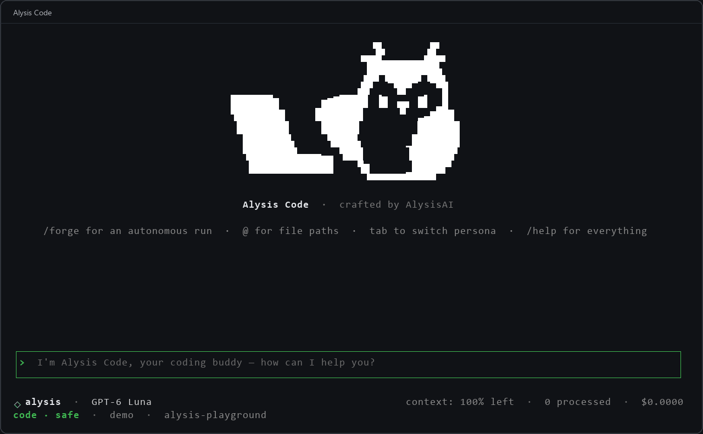

<p align="center">
  <picture>
    <source media="(prefers-color-scheme: dark)" srcset="docs/assets/banner-dark.svg">
    
  </picture>
</p>

<p align="center">
  An open-source coding agent for your terminal.<br>
  Bring your own model. Turn plans into reviewed, PR-ready code.
</p>

<p align="center">
  <a href="https://alysiscode.com/">Website</a> ·
  <a href="https://alysiscode.com/docs">Documentation</a> ·
  <a href="docs/quickstart.md">Quickstart</a> ·
  <a href="docs/CHANGELOG.md">Changelog</a>
</p>

<p align="center">
  <a href="https://github.com/AlysisAi/AlysisCode/stargazers"></a>
  <a href="https://github.com/AlysisAi/AlysisCode/actions/workflows/ci.yml"></a>
  <a href="https://pypi.org/project/alysis-code/"></a>
  <a href="https://pypi.org/project/alysis-code/"></a>
  <a href="https://pypi.org/project/alysis-code/"></a>
  <a href="https://github.com/AlysisAi/AlysisCode/blob/main/LICENSE"></a>
</p>

<p align="center">
  <a href="https://x.com/alysiscode">Follow on X</a> ·
  <a href="https://github.com/sponsors/AlysisAi">Sponsor the project</a>
</p>

<p align="center">
  
  <br>
  <sub>From the welcome screen to your first conversation. Real CLI recording; pauses shortened.</sub>
</p>

---

## Get Started

Alysis Code requires **Python 3.11+** and runs on macOS, Linux, and Windows.

**1 — Install**

On Windows, paste this into **PowerShell**:

```powershell
irm https://raw.githubusercontent.com/AlysisAi/AlysisCode/main/scripts/install.ps1 | iex
```

On Linux, macOS, or inside a **WSL/Ubuntu terminal**:

```sh
curl -LsSf https://raw.githubusercontent.com/AlysisAi/AlysisCode/main/scripts/install.sh | sh
```

The installers provision uv and Python 3.12 when needed. No existing Python or pipx is required.
PowerShell can use `alysis` immediately; after the shell installer, follow its PATH instructions
or open a new terminal. If you already use pipx, `pipx install alysis-code` also works;
run `pipx ensurepath` and restart your terminal if the command is missing.
Already installed? Run `alysis update` to get the latest release.

**2 — Choose how to connect to a model**

Pick one path. You can switch later with `/config` or by re-running `alysis-code setup`.

*Path A — Your own API key or a local model (no Alysis account needed)*

```bash
cd your-project
alysis-code
```

The first run opens a guided setup wizard. Choose **Use an API key**, connect a provider
(OpenAI, Anthropic, DeepSeek, Gemini, OpenRouter, and more), and pick your default model.
To run fully offline, point Alysis Code at a local endpoint (Ollama, LM Studio, vLLM) from the
`/config` picker, which lists every preset. Prefer to configure it by hand?

```bash
export ALYSIS_API_KEY="YOUR_KEY"
alysis config set base_url "https://api.openai.com/v1"
alysis config set model "gpt-4.1-mini"
```

Have a ChatGPT subscription instead? Choose **Use an AI subscription** in the wizard, or run
`alysis auth login openai-codex`.

*Path B — Alysis account*

```sh
alysis login
```

Approve the code in your browser to use your Alysis credits. No provider key and no cloud
environment variables are needed.

**3 — Start building**

```bash
cd your-project
alysis-code chat                            # interactive coding session
alysis-code run "Fix the failing tests"     # one-shot task
```

(`alysis` works too, as a short alias.) The `/config` picker lists every provider preset.
Full walkthrough: [Quickstart guide](docs/quickstart.md).

## Alysis Code App

Alysis Code App is powered by the open-source Alysis Code engine, bringing an agentic desktop experience to coding and broader everyday work.

---

## Why Alysis Code

Alysis Code brings model choice, coordinated execution, and verification into one open-source
workflow — from your first question to a change you can review and ship.

- **[Your model, your workflow](https://alysiscode.com/docs/config/models)** — use OpenAI, Anthropic,
  Gemini, DeepSeek, Qwen, Mistral, OpenRouter, xAI, and more. Connect your own key without an Alysis
  account, or use Ollama, LM Studio, or vLLM for local inference.
- **[Forge: turn a plan into verified changes](docs/forge.md)** — execute tasks in dependency order,
  retain verification and review evidence, and resume interrupted runs. Strict verification blocks
  integration when checks fail; independent tasks can run in parallel with `forge swarm`.
- **[Parallel work you can inspect before applying](docs/subagents.md#parallel-writers-and-pinned-verification)**
  — isolated workers prepare changes in separate Git worktrees. A verifier can check the exact
  candidate while your working tree stays unchanged; applying it runs host-side conflict checks.
- **[Our own sandbox layer](#alysis-sandbox)** — Alysis Sandbox combines strict command execution,
  native OS backends, and Alysis-maintained container images for development and server workers.
- **Free built-in web search** — research documentation and current information with any supported
  model, without a separate search API key. Model usage still follows your provider's pricing.
- **[Extend the whole workflow](https://alysiscode.com/docs/concepts/plugins)** — package skills,
  custom tools, MCP servers, hooks, and specialist subagents together in a declarative plugin manifest.
- **A terminal that stays easy to use** — guided setup, interactive pickers, slash commands, and live
  status, with the same engine available for one-shot tasks, scripts, and CI.

## Alysis Sandbox

**Alysis Sandbox is our own open-source execution layer**, backed by Docker, Linux Bubblewrap,
or macOS Seatbelt. Shell and verification commands default to strict sandboxing.

- **Controlled execution.** Networking defaults to `off`; the macOS backend still permits localhost.
  Docker commands drop Linux capabilities and do not inherit the host environment by default.
  The CLI refuses execution when no backend is available unless you explicitly configure a fallback.
- **Our own development images.** `ghcr.io/alysisai/alysis-sandbox` provides `base`, `dev`, and
  `server` variants. The image build uses pinned, verified inputs for both AMD64 and ARM64;
  deployments can pin an image digest for repeatable environments.
- **Protection beyond approval prompts.** Repository metadata protection and the command denylist
  remain separate from permission modes, including `fullaccess`.

Set up and check your sandbox:

```bash
alysis sandbox setup
alysis sandbox doctor --smoke
```

The sandbox covers shell and verification execution; the workspace remains writable for the task.
See the [sandbox guide](docs/shell_sandbox.md) for backend differences and setup, and the
[image build](scripts/sandbox/README.md) for the supply-chain details.

## How it compares

Comparing current terminal agents: **Claude Code, Codex CLI, OpenCode, and Gemini CLI**.
Alysis Code's strength is the combination: broad model choice, Forge orchestration, verification
before applying isolated work, and an integrated sandbox — all in an Apache-2.0 CLI.

| Agent | Model choice | Coordinating larger tasks | Shell isolation |
| --- | --- | --- | --- |
| **Alysis Code** | **Multiple providers + local models** | **Forge plans, parallel worktrees, verify-before-apply, conflict checks** | **Alysis Sandbox: strict by default, own images + native backends** |
| Claude Code | [Claude models](https://code.claude.com/docs/en/model-config) | [Subagents and experimental agent teams](https://code.claude.com/docs/en/agent-teams) | [Sandboxed Bash with filesystem and network controls](https://code.claude.com/docs/en/sandboxing) |
| Codex CLI | [OpenAI + local models](https://learn.chatgpt.com/docs/developer-commands?surface=cli); [custom providers](https://learn.chatgpt.com/docs/model-catalogs) | [Parallel subagents with configurable roles](https://learn.chatgpt.com/docs/agent-configuration/subagents) | [Sandbox and approval policies](https://learn.chatgpt.com/docs/developer-commands?surface=cli) |
| OpenCode | [Multiple providers + local models](https://opencode.ai/docs/providers/) | [Build/Plan agents and parallel subagents](https://opencode.ai/docs/agents/) | [Permissions; use an external container or VM for isolation](https://github.com/anomalyco/opencode/blob/dev/SECURITY.md) |
| Gemini CLI | [Gemini models](https://geminicli.com/docs/cli/model/) | [Specialist subagents and remote A2A agents](https://geminicli.com/docs/core/subagents/) | [Container and native OS sandbox options](https://geminicli.com/docs/cli/sandbox/) |

Based on the linked official documentation, checked **October 25, 2026**. This compares the CLI
workflows, not every desktop or cloud feature. Capabilities and defaults vary by platform and
configuration; the table is not a performance benchmark.

## Permissions & Personas

Two layers control what the agent may do — one enforces, one focuses.

**Permissions** are the enforcement layer. Choose one per command with `--mode`, select the next
message's level in chat with `/permissions` or **Shift+Tab**, or set a default with
`alysis-code config set default_mode <mode>`. A selection takes effect when the next user message
starts; it does not change a turn already running:

| Mode | Behavior |
| --- | --- |
| `readonly` | Inspection plus top-level read-only delegation — no file writes, shell, MCP, candidate apply/discard, or nested delegation. |
| `review` | The safe default — previews and asks before every write and shell command. |
| `auto` | Applies routine edits with fewer prompts; dangerous operations stay blocked. |
| `fullaccess` | No mode-level prompts for trusted workspaces — the denylist and audit log stay active. |

**Personas** are working postures layered on top. Switch with `/persona`, or cycle with **Tab** in
the TUI:

| Persona | Posture |
| --- | --- |
| `code` | Implementation — the default, full coding workflow. |
| `architect` | Planning and design — may write markdown documents only. |
| `ask` | Read-only questions and codebase exploration. |
| `debug` | Reproduce the failure first, then fix minimally and rerun the reproduction. |

A persona is a convention, never a permission: it can keep or lower your execution mode, but can
never raise it. Define your own in `.alysis_personas/*.md`.
[Learn more](https://alysiscode.com/docs/concepts/personas)

Use `/persona architect` for planning in chat, or `/forge` for a plan-driven execution workflow.
The former chat `/plan` commands have been removed; Forge retains its plan views and editor.
Persona changes made during a running turn apply after that turn finishes.

## Project Links

- [Website](https://alysiscode.com/)
- [Documentation](https://alysiscode.com/docs) — also mirrored in [docs/](docs/README.md)
- [Changelog](docs/CHANGELOG.md)
- [Contributing](.github/CONTRIBUTING.md) — local setup and PR expectations
- [Security policy](.github/SECURITY.md) — report vulnerabilities privately, never through public issues

## License

Apache-2.0. You're free to use, modify, and distribute this code, including commercially, as long as
you keep the attribution and license notices. See [LICENSE](LICENSE) and [NOTICE](NOTICE).
The shared editor sidebar includes MIT-licensed adaptations from Kilo Code/OpenCode; retain its
[third-party notices](extensions/shared-ui/THIRD_PARTY_NOTICES.txt).

## FAQ

<details>
<summary><b>Where did Alysis Code come from?</b></summary>

Alysis Code is not a fork. The agent runtime, Forge orchestration, subagent system, terminal
interface, and sandbox layer were designed and built from zero by the Alysis AI team.
</details>

<details>
<summary><b>Is Alysis Code really open source?</b></summary>

Yes. The entire CLI is Apache-2.0 licensed. Bring your own API key from any supported provider, or
run fully offline against a local endpoint — nothing in the agent requires a paid account.
</details>

More questions? See the [full FAQ](https://alysiscode.com/docs/faq).

---

**Join the community** — [X](https://x.com/alysiscode) | [GitHub Issues](https://github.com/AlysisAi/AlysisCode/issues)


## Editor integrations

[VS Code](extensions/vscode-alysis/README.md) uses the shared Alysis sidebar and Python IDE bridge.
[JetBrains](extensions/jetbrains-alysis/README.md) is a development preview with a smaller feature set.
The VS Code Marketplace pre-release is pending production signing and acceptance; see the
[IDE release status](docs/vscode-marketplace-launch.md) before installing component packages.
