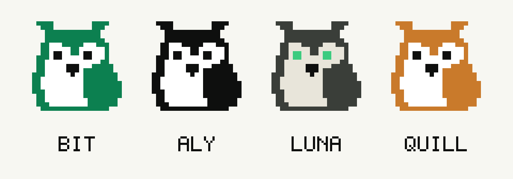
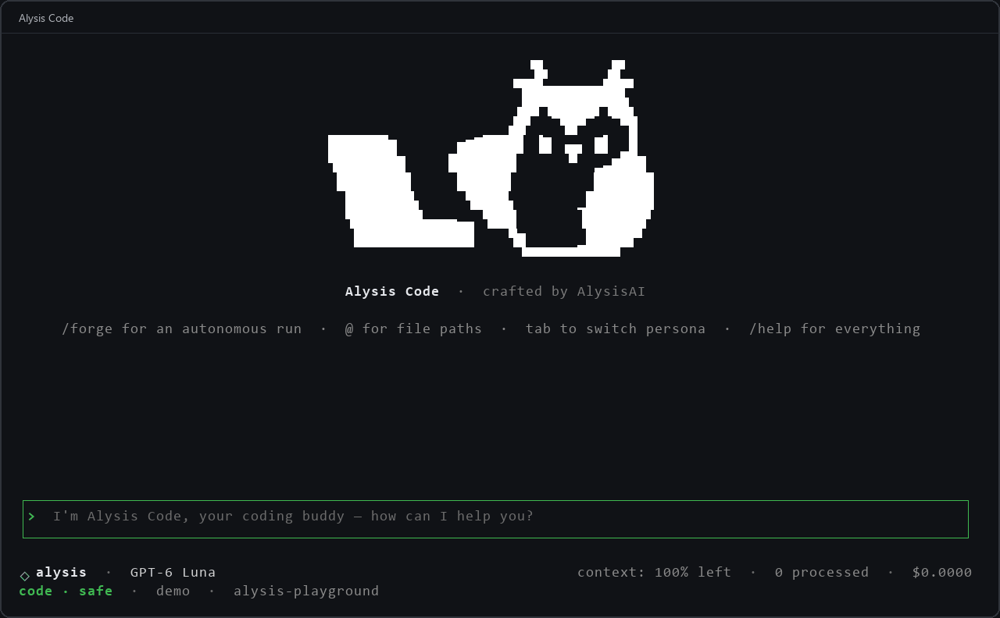
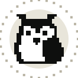

<p align="center">
  <a href="https://alysiscode.com">
    <picture>
      <source media="(prefers-color-scheme: dark)" srcset="docs/assets/brand/alysis-banner-dark.svg">
      
    </picture>
  </a>
</p>

<h3 align="center">A team of owls for all your work.</h3>

<p align="center">
  Alysis gives you a team of AI owls that write, research, build and keep your everyday jobs running on your computer. Tell an owl what you need in plain words, and it gets it done, even while you sleep.
</p>

<p align="center">
<a href="https://pypi.org/project/alysis-code/"></a>
<a href="https://github.com/AlysisAi/AlysisCode/blob/main/LICENSE"></a>
<a href="https://github.com/AlysisAi/AlysisCode"></a>
<a href="https://discord.gg/psEVWZgzFS"></a>
</p>

## Meet the owls

<p align="center">
  
</p>

- 🟩 **Code owls** (Bit) build, fix and test software in your projects, show every change, and roll back to a checkpoint.
- 📄 **Work owls** (Quill) turn notes, files and research into documents, spreadsheets, slides and PDFs you can preview and revise.
- 🌙 **Night owls** (Luna) keep working on their own, with memory, routines and their own computer, on your machine, in the cloud or from your Android phone.
- 💸 **Plans from $1**, or bring your own API keys and subscriptions.

<p align="center">
  <strong><a href="https://alysiscode.com/#desktop-download">Download Alysis for macOS &amp; Windows</a></strong> · plans from $1 ·
  <a href="#run-it-in-your-terminal">Install the CLI</a> ·
  <a href="https://alysiscode.com/docs">Docs</a> ·
  <a href="https://discord.gg/psEVWZgzFS">Discord</a> ·
  <a href="https://x.com/alysis_ai">X</a>
</p>

> **Any AI model, no lock-in.** Use Claude, GPT, Gemini, DeepSeek or a local model with Ollama or LM Studio. Bring your own API keys or subscription, or start with Alysis credits, and switch any time. Everything runs on the open-source Apache-2.0 engine in this repository.

<p align="center">
  <a href="https://alysiscode.com/#desktop-download">
    
  </a>
</p>

## Why Alysis

**Any AI, no lock-in.** Use Claude, GPT, Gemini, DeepSeek or a local model. Bring your own keys or subscription, or just start with Alysis credits. Switch any time.

**Works while you sleep.** Night owls keep your routines going on your computer or in the cloud, so you wake up to a done list.

**Open and affordable.** Plans from $1, on an open-source Apache-2.0 engine you can read, change and run yourself.

Shell commands run in a sandbox by default. Verification commands also default to strict sandboxing: strict mode refuses execution when no backend is available. Work that reaches other people, pays, publishes or deletes waits for your approval. [How permissions work](https://alysiscode.com/docs/safety/approval-prompts) · [Shell sandbox](https://github.com/AlysisAi/AlysisCode/blob/main/docs/shell_sandbox.md)

## Get started

1. [Download the desktop app](https://alysiscode.com/#desktop-download) for macOS (Apple silicon) or Windows (x64). No Python or terminal setup needed.
2. Sign in for Alysis credits, or connect your own model in **Models & keys**.
3. Open a repository with Code owls, bring a file to Work owls, or give a Night owl a routine.

[Desktop guide](https://alysiscode.com/docs/desktop) · [Your first task](https://alysiscode.com/docs/desktop/first-task) · [Release notes](https://github.com/AlysisAi/AlysisCode/releases)

## Run it in your terminal

The same engine runs as the `alysis` CLI on macOS, Linux and Windows.

<p align="center">
  
</p>

```bash
# macOS, Linux and WSL
curl -LsSf https://raw.githubusercontent.com/AlysisAi/AlysisCode/main/scripts/install.sh | sh
```

```powershell
# Windows PowerShell
irm https://raw.githubusercontent.com/AlysisAi/AlysisCode/main/scripts/install.ps1 | iex
```

The installers manage Python for you. Then run `alysis login` to use your Alysis credits, and `alysis` inside a project to start. `alysis update` upgrades.

Already on Python 3.11+? `uv tool install alysis-code` or `pipx install alysis-code`.

[CLI documentation](https://alysiscode.com/docs) · [VS Code extension](https://github.com/AlysisAi/AlysisCode/blob/main/extensions/vscode-alysis/README.md) · [JetBrains preview](https://github.com/AlysisAi/AlysisCode/blob/main/extensions/jetbrains-alysis/README.md)

## What's in this repository

| Path | What lives there |
| --- | --- |
| [`src/alysis_code/`](https://github.com/AlysisAi/AlysisCode/tree/main/src/alysis_code) | The engine and the `alysis` CLI: agent loop, model providers, tools, MCP client, sandboxing |
| [`src/alysis_code/bots/`](https://github.com/AlysisAi/AlysisCode/tree/main/src/alysis_code/bots) | The Night owls runtime: routines, memory, approvals, and the owl's computer |
| [`extensions/`](https://github.com/AlysisAi/AlysisCode/tree/main/extensions) | VS Code extension, JetBrains preview and their shared UI |
| [`docs/`](https://github.com/AlysisAi/AlysisCode/tree/main/docs) | [Architecture](https://github.com/AlysisAi/AlysisCode/blob/main/docs/architecture.md), [security model](https://github.com/AlysisAi/AlysisCode/blob/main/docs/security_model.md), [MCP](https://github.com/AlysisAi/AlysisCode/blob/main/docs/mcp.md), [skills](https://github.com/AlysisAi/AlysisCode/blob/main/docs/skills.md), [plugins](https://github.com/AlysisAi/AlysisCode/blob/main/docs/plugins.md) |

## Community

[Join the Discord](https://discord.gg/psEVWZgzFS), [report a bug](https://github.com/AlysisAi/AlysisCode/issues), follow [@alysis_ai](https://x.com/alysis_ai), or read the [contributing guide](https://github.com/AlysisAi/AlysisCode/blob/main/.github/CONTRIBUTING.md). Report vulnerabilities privately through the [security policy](https://github.com/AlysisAi/AlysisCode/blob/main/.github/SECURITY.md).

If Alysis saves you time, a star helps other people find it.

## License

The engine and CLI in this repository are licensed under Apache-2.0. See [LICENSE](https://github.com/AlysisAi/AlysisCode/blob/main/LICENSE), [NOTICE](https://github.com/AlysisAi/AlysisCode/blob/main/NOTICE), and the editor sidebar's [third-party notices](https://github.com/AlysisAi/AlysisCode/blob/main/extensions/shared-ui/THIRD_PARTY_NOTICES.txt).

<p align="center">
  <br>
  <sub>Made by <a href="https://alysisai.com">Alysis AI</a>. A team of owls for all your work.</sub>
</p>
