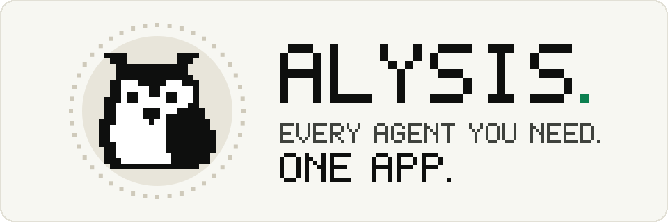
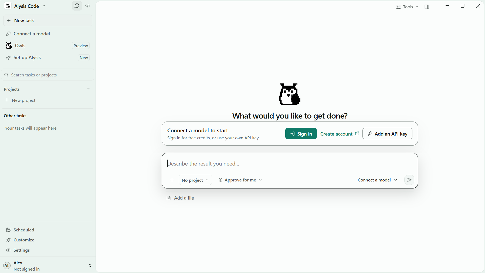

<p align="center">
  <a href="https://alysiscode.com">
    <picture>
      <source media="(prefers-color-scheme: dark)" srcset="https://raw.githubusercontent.com/AlysisAi/AlysisCode/main/docs/assets/brand/alysis-banner-dark.svg">
      
    </picture>
  </a>
</p>

<p align="center">
  <strong>Alysis writes code, builds documents and runs everyday jobs on your computer.</strong><br>
  Any model you choose. It asks before it acts. Open-source engine, built in Athens.
</p>

<p align="center">
<a href="https://pypi.org/project/alysis-code/"></a>
<a href="https://pypi.org/project/alysis-code/"></a>
<a href="https://github.com/AlysisAi/AlysisCode/actions/workflows/ci.yml"></a>
<a href="https://github.com/AlysisAi/AlysisCode/blob/main/LICENSE"></a>
<a href="https://github.com/AlysisAi/AlysisCode"></a>
<a href="https://discord.gg/psEVWZgzFS"></a>
</p>

<p align="center">
  <strong><a href="https://alysiscode.com/#desktop-download">Download for macOS &amp; Windows</a></strong> ·
  <a href="#run-it-in-your-terminal">Install the CLI</a> ·
  <a href="https://alysiscode.com/docs">Docs</a> ·
  <a href="https://discord.gg/psEVWZgzFS">Discord</a> ·
  <a href="https://x.com/alysis_ai">X</a>
</p>

<p align="center">
  <a href="https://alysiscode.com/#desktop-download">
    
  </a>
</p>

## Three agents, one app

| | What it does | Try asking |
| --- | --- | --- |
| **Alysis Code** | Builds, fixes and tests software in your repositories. Shows its changes, runs commands in a built-in terminal, and rolls back to a checkpoint. | *"Add search to my notes app. Include keyboard shortcuts and tests."* |
| **Alysis Work** | Turns notes, files and research into Word documents, spreadsheets, slides and PDFs. Preview the result, select what to change, ask for a revision. | *"Compare the three supplier quotes in Quotes and build a one-page summary spreadsheet."* |
| **Alysis Owls** | Assistants that keep working on their own, with memory, routines and a private computer, on this machine or in the cloud. | *"Check every new invoice against its quote and flag anything that doesn't match."* |

## Why Alysis

**Any model, no lock-in.** Use Claude, GPT, Gemini, DeepSeek or an open model. Sign in for Alysis credits, bring your own API keys, or run local models with Ollama or LM Studio. Switch any time.

**It asks before it acts.** Shell commands run in a sandbox by default. Owls ask for your approval before anything that reaches other people, pays, publishes or deletes. [How permissions work](https://alysiscode.com/docs/safety/approval-prompts) · [Shell sandbox](https://github.com/AlysisAi/AlysisCode/blob/main/docs/shell_sandbox.md)

**It keeps working when you don't.** Owls run routines on a schedule. Cloud owls keep going after you close the laptop.

**The engine is open.** Everything the agent does runs on the Apache-2.0 engine in this repository. Read it, change it, run it yourself.

## Get started

1. [Download the desktop app](https://alysiscode.com/#desktop-download) for macOS (Apple silicon) or Windows (x64). No Python or terminal setup needed.
2. Sign in for free Alysis credits, or connect your own model in **Models & keys**.
3. Open a repository in Code, bring a file into Work, or create your first owl.

[Desktop guide](https://alysiscode.com/docs/desktop) · [Your first task](https://alysiscode.com/docs/desktop/first-task) · [Release notes](https://github.com/AlysisAi/AlysisCode/releases)

## Run it in your terminal

The same engine runs as the `alysis` CLI on macOS, Linux and Windows.

<p align="center">
  
</p>

```bash
# macOS, Linux and WSL
curl -LsSf https://raw.githubusercontent.com/AlysisAi/AlysisCode/main/scripts/install.sh | sh
```

```powershell
# Windows PowerShell
irm https://raw.githubusercontent.com/AlysisAi/AlysisCode/main/scripts/install.ps1 | iex
```

The installers manage Python for you. Then run `alysis login` to use your Alysis credits, and `alysis` inside a project to start. `alysis update` upgrades.

Already on Python 3.11+? `uv tool install alysis-code` or `pipx install alysis-code`.

[CLI documentation](https://alysiscode.com/docs) · [VS Code extension](https://github.com/AlysisAi/AlysisCode/blob/main/extensions/vscode-alysis/README.md) · [JetBrains preview](https://github.com/AlysisAi/AlysisCode/blob/main/extensions/jetbrains-alysis/README.md)

## What's in this repository

| Path | What lives there |
| --- | --- |
| [`src/alysis_code/`](https://github.com/AlysisAi/AlysisCode/tree/main/src/alysis_code) | The engine and the `alysis` CLI: agent loop, model providers, tools, MCP client, sandboxing |
| [`src/alysis_code/bots/`](https://github.com/AlysisAi/AlysisCode/tree/main/src/alysis_code/bots) | The Owls runtime: routines, memory, approvals, the owl's computer |
| [`extensions/`](https://github.com/AlysisAi/AlysisCode/tree/main/extensions) | VS Code extension, JetBrains preview and their shared UI |
| [`docs/`](https://github.com/AlysisAi/AlysisCode/tree/main/docs) | [Architecture](https://github.com/AlysisAi/AlysisCode/blob/main/docs/architecture.md), [security model](https://github.com/AlysisAi/AlysisCode/blob/main/docs/security_model.md), [MCP](https://github.com/AlysisAi/AlysisCode/blob/main/docs/mcp.md), [skills](https://github.com/AlysisAi/AlysisCode/blob/main/docs/skills.md), [plugins](https://github.com/AlysisAi/AlysisCode/blob/main/docs/plugins.md) |

## Community

[Join the Discord](https://discord.gg/psEVWZgzFS), [report a bug](https://github.com/AlysisAi/AlysisCode/issues), follow [@alysis_ai](https://x.com/alysis_ai), or read the [contributing guide](https://github.com/AlysisAi/AlysisCode/blob/main/.github/CONTRIBUTING.md). Report vulnerabilities privately through the [security policy](https://github.com/AlysisAi/AlysisCode/blob/main/.github/SECURITY.md).

If Alysis saves you time, a star helps other people find it.

## License

The engine and CLI in this repository are licensed under Apache-2.0. See [LICENSE](https://github.com/AlysisAi/AlysisCode/blob/main/LICENSE), [NOTICE](https://github.com/AlysisAi/AlysisCode/blob/main/NOTICE), and the editor sidebar's [third-party notices](https://github.com/AlysisAi/AlysisCode/blob/main/extensions/shared-ui/THIRD_PARTY_NOTICES.txt).

<p align="center">
  <br>
  <sub>Built in Athens by <a href="https://alysisai.com">Alysis AI</a>.</sub>
</p>
